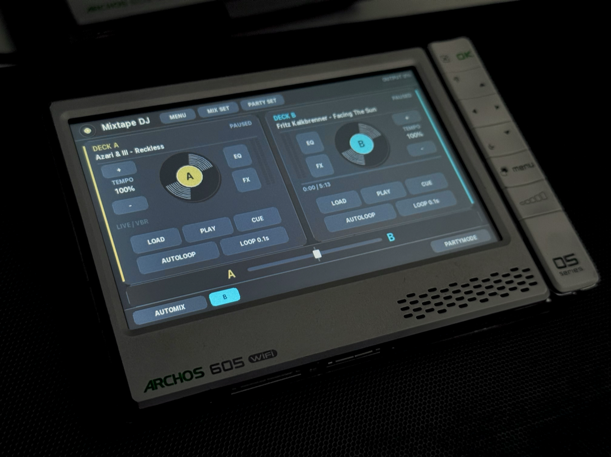

# Mixtape DJ — User Manual

Mixtape DJ is the native two-deck MP3 player included with MixtapeOS. It is designed for the Archos 605F and 605 HDD and provides a touch-first DJ environment with two decks, a crossfader, EQ, effects, loops, automix and Party Mode.

## Quick start

1. Copy your MP3 files to `/mnt/data/Music`.
2. Open **Mixtape DJ** from the Info menu.
3. Wait for `INIT AUDIO` to disappear and for the decks to become ready.
4. Open **MUSIC LIBRARY**, choose a folder and select a track.
5. Load the track on **DECK A** or **DECK B**.
6. Press **PLAY** on the deck you want to hear.
7. Use the crossfader, deck volume and EQ to mix the two decks.

Mixtape DJ uses the existing Archos audio path. For the best results at 44.1 kHz stereo, use a buffer of around 300 ms.

## Main interface

| Area | Description |
|---|---|
| Title bar | `MENU`, `MIX SET` and `PARTY SET` |
| Deck A / Deck B | Track information, tempo, EQ, FX and transport controls |
| Center mixer | Crossfader and deck gain |
| Bottom bar | Automix destination, Automix and Party Mode |
| Status bar | Battery, CPU, RAM and output level |
| Vinyls | Animated deck indicators; tap a playing vinyl to pause/resume |

## Music library

Open **MUSIC LIBRARY** to browse the folders found under `/mnt/data/Music`.

- Use the folder list to choose an album or directory.
- Select a track from the track list.
- Load the selected track into **Deck A** or **Deck B**.
- The library remembers the current folder while the app is running.
- Only MP3 files are supported.

If the library is empty, check that the files are really MP3 files and that they are stored under `/mnt/data/Music`.

## Deck controls

| Control | Function |
|---|---|
| `LOAD` | Open the music library and load a track into this deck |
| `PLAY` / `PAUSE` | Start or pause playback |
| `CUE` | Set and preview the cue point |
| `TEMPO` | Adjust pitch/tempo with `+` and `-` |
| `EQ` | Open the three-band equalizer |
| `FX` | Open the effects panel |
| `AUTOLOOP` | Loop the current section |
| Vinyl | Tap a playing vinyl to pause/resume |

### CUE

Pressing **CUE** while stopped sets the cue point at the current position. While playing, pressing **CUE** pauses the deck and returns to the cue point.

Hold **CUE** to preview the cue point. Release it to return; release over **PLAY** to continue playback from the cue point.

### Autoloop

**AUTOLOOP** loops the current audio. The loop length can be changed with the loop-length control. The loop is removed when you release the loop control or press it again, depending on the current action.

### EQ

Each deck has a three-band equalizer:

- **LOW**
- **MID**
- **HIGH**
- **KILL** removes the selected band completely.
- Each band can be boosted or cut independently.

Changes are applied to the deck output in real time.

### Effects

The effect panel provides:

| Effect | Parameters |
|---|---|
| **FILTER** | Cutoff |
| **ECHO** | Time, feedback, mix |
| **FLANGER** | Rate, depth, mix |
| **CRUSH** | Bits, hold |

Each effect can be enabled with **ON/OFF** and adjusted with `+` / `-`. Effects add CPU load, especially when both decks are playing.

## Mixing

- **Crossfader**: moves the mix between Deck A and Deck B.
- **Deck gain**: adjusts the level of each deck before the mix.
- **EQ**: useful for bass swaps and smooth transitions.
- **Effects**: can be applied while mixing, but keep an eye on CPU usage.

Use a slower crossfade for long mixes and a faster movement for cuts. The audio buffer gives some protection against short CPU or storage peaks, but it cannot compensate for sustained overload.

## Automix

Press **AUTOMIX** in the bottom bar to start an automatic transition.

Before starting:

- Choose the destination deck with the **A/B** button.
- Set the transition duration in **AUTOMIX SET**.
- Optionally configure EQ and effects for the automatic transition.
- Choose whether the live decks keep their VU/progress animations with **AUTOMIX: LIVE DECKS**.

During automix:

- The outgoing deck is mixed into the destination deck.
- The transition follows the configured duration.
- Both vinyl animations are hidden to reduce CPU load.
- At the end, the destination deck becomes active and the destination selection is inverted for the next transition.

Press **AUTOMIX** again to cancel an automatic transition.

## Party Mode

**PARTYMODE** turns Mixtape DJ into an automatic playback system.

Open **PARTY SET** to configure:

| Setting | Description |
|---|---|
| **Track end lead** | How early the next track is prepared |
| **Play lead** | How early the destination deck starts |
| **Track select** | Select tracks by name or shuffle |
| **Loop list** | Restart the playlist after the last track |
| **Folders / Playlist** | Choose which folders or tracks are included |

Party Mode prepares the next track on the inactive deck while the current track is playing. When the current track approaches its end, the next track is started and the automix transition is performed automatically.

Press **PARTYMODE** again, or use the Party Mode stop control, to leave automatic playback.

## Settings

Open **SETTINGS** from the title bar.

| Setting | Options |
|---|---|
| **Start volume** | Initial output volume |
| **Audio quality** | 22.05 kHz or 44.1 kHz |
| **Output** | Mono or stereo |
| **Audio buffer** | Ring-buffer size |
| **FPS LIVE** | UI refresh rate, 20–70 FPS |
| **VU METER** | On/off |
| **AUTOMIX: LIVE DECKS** | Keep VU/progress animations during automix |
| **FPS MONITOR** | Show the FPS counter |
| **VINYL START/STOP EFFECT** | Enable the vinyl pause/start effect |
| **CLOSE DJ** | Exit the application |

Settings are stored in `/mnt/data/Apps/App_DJ/dj.config` and restored the next time the app starts.

## Performance tips

- Use 44.1 kHz stereo when sound quality matters.
- Keep the audio buffer around 300 ms for 44.1 kHz stereo.
- Avoid enabling every effect on both decks at the same time.
- Reduce the UI FPS or VU animation if the interface feels slow.
- During automix, leave the vinyl animations disabled to save CPU.
- Store music on the internal data partition rather than on a slow external volume.

The Archos 605 has an ARM926 CPU without a floating-point unit. Heavy effects, two simultaneous decoders and high UI frame rates can exhaust the available CPU.

## Troubleshooting

### `INIT AUDIO` remains on screen

- Close other apps that may be holding `/dev/dsp`.
- Open the audio diagnostics page and check the DSP/mixer status.
- Retry audio initialization.
- If the problem persists, restart MixtapeOS and check the launch log.

### The library is empty

- Verify that the files are MP3 files.
- Place them under `/mnt/data/Music`.
- Check that the filesystem is mounted and readable.

### Audio crackles or drops

- Raise the audio buffer.
- Reduce the number of active effects.
- Lower the FPS or disable VU animations.
- Check CPU and RAM from **MTOS Settings**.

### A deck does not load

- Try a lower-bitrate MP3 to check whether the file is damaged.
- Check free space on `/mnt/data`.
- Restart Mixtape DJ if the audio path is stuck.

## Related documentation

- [MTOS Settings](Manual_MTOSSET.md)
- [File Explorer](Manual_FILEEXPLORER.md)
- [Audio architecture](docs/21-audio.html)
- [App_DJ audio performance](docs/22-appdj-audio-performance.html)
- [App_DJ UI performance](docs/23-appdj-ui-performance.html)
