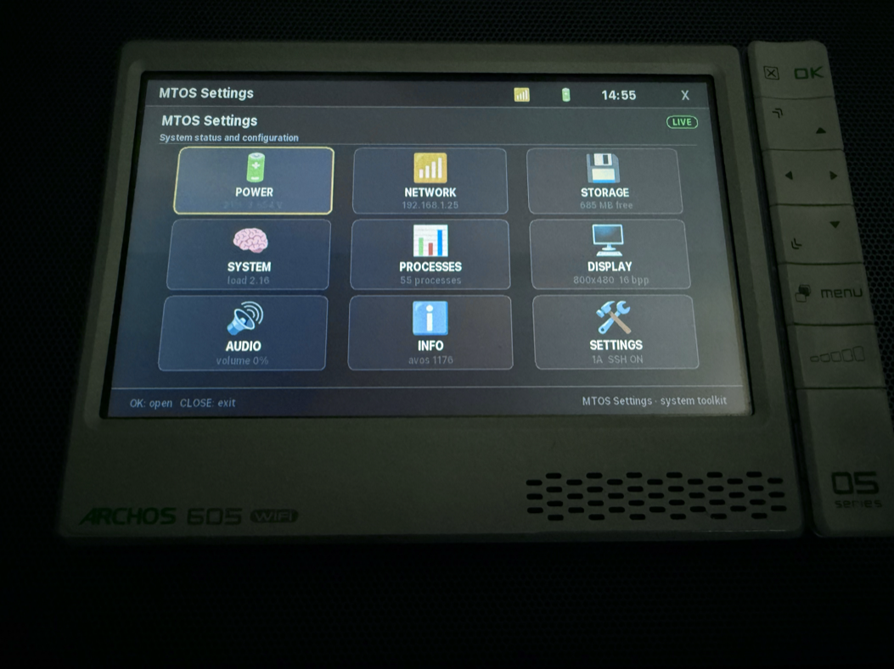

# MTOS Settings — User Manual

MTOS Settings is the native system dashboard included with MixtapeOS. It is available from the Info menu.



## Overview

MTOS Settings is a touch-friendly system dashboard. The home screen contains nine live sections:

| Section | Contents |
|---|---|
| **POWER** | Battery voltage, charge state, power source and consumption |
| **NETWORK** | Interface state, IP address, MAC address, gateway, DNS, signal and traffic |
| **STORAGE** | Data partition usage and mounted filesystems |
| **SYSTEM** | Kernel, CPU, temperature, uptime, load and memory |
| **PROCESSES** | Process summary and top processes by RSS |
| **DISPLAY** | Framebuffer, backlight and input/touch information |
| **AUDIO** | OSS mixer, PCM levels and audio devices |
| **INFO** | Serial, MAC, kernel, build, AVOS and recent events |
| **SETTINGS** | Runtime configuration described below |

Tap a card to open its live view. Some detailed views expose a **LIVE / LOG** switch.

### Settings and defaults

Open **SETTINGS** from the home screen.

| Setting | Default | What it does |
|---|---|---|
| **SSH SERVER** | **OFF** | Enables or disables the SSH server |
| **SSH USER** | **mix** | Username used for SSH access |
| **SSH PASSWORD** | **tape** | Initial password; change it before enabling SSH |
| **CHARGE CURRENT** | **1A** | Selects 1A or 0.5A charging |
| **SMB FIX** | **ON** | Starts the SMB2/SMB3 filesystem layer |
| **RADIO/TV FIX** | **ON** | Enables the local Radio/WebTV compatibility layer |
| **DEBUG LOGS** | **OFF** | Enables extra diagnostic logging |
| **WI-FI AUTOCONNECT** | **OFF** | Connects to the saved Wi-Fi network at boot |
| **BOOT PROGRESS** | **OFF** | Shows the boot logo phase text/progress |

Defaults are applied only when the corresponding files are missing. Settings are stored in:

```text
/mnt/system/settings/
```

Existing settings survive firmware updates.

### SSH server

When enabled, the SSH server starts automatically at boot. The default user is `mix`; the initial password is `tape`.

Change both the user and password from the settings screen before enabling SSH. The `mix` account has UID 0 and is effectively root-equivalent.

SSH keys are stored in:

```text
/mnt/system/settings/ssh_keys/
```

The per-device host key is generated on first use.

### SMB fix

SMB fix provides SMB2/SMB3 support through `fusesmb`. When enabled, it:

- waits for `/opt` and the FUSE device;
- replaces the stock SMB1 helpers with the MixtapeOS versions;
- mounts the SMB filesystem under `/mnt/net`;
- uses `/mnt/system/etc/fusesmb.conf`.

Disabling it stops the SMB background service. A configured SMB server is still required in `fusesmb.conf`.

### Radio/TV fix

Radio/TV fix prepares the local vTuner/WebTV compatibility files and serves the editable web data from `/mnt/data/web`.

The fix is enabled by default. Disabling it removes the generated Radio/WebTV compatibility directory and leaves the stock behavior in place.

### Debug logs

Debug logs are off by default. When enabled, MixtapeOS creates:

```text
/mnt/system/debug
```

This marker enables additional logging in services such as SMB and the app launcher. Debug logs consume space and add I/O overhead, so keep them disabled during normal use.

### Wi-Fi autoconnect

When enabled, MixtapeOS runs a one-shot Wi-Fi connection helper after AVOS is ready. It uses the saved network configuration and writes its activity to:

```text
/mnt/system/wifi_autoconnect.log
```

The default is **OFF**. Enabling the setting takes effect on the next boot.

### Boot progress

Boot progress controls the phase text shown by `bootphase` during boot. With the default **OFF**, no phase text is drawn; the boot logo is still handled by the normal display path.

Changes take effect on the next boot.

### Charge current

Two modes are available:

- **1A**
- **0.5A**

The selected value is written to:

```text
/mnt/system/settings/charge_current
```

and applied by the battery helper.

## Related documentation

- [Mixtape DJ manual](Manual_MIXTAPEDJ.md)
- [File Explorer manual](Manual_FILEEXPLORER.md)
- [Wi-Fi and MTOS settings](docs/25-wifi-avos.html)
- [Application packages](docs/24-app-packages.html)
- [MixtapeOS changelog](docs/28-mixtapeos.html)
