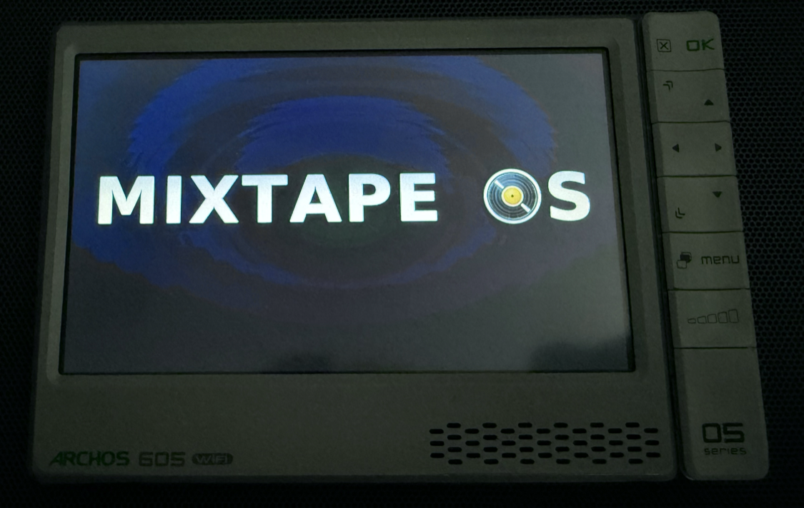
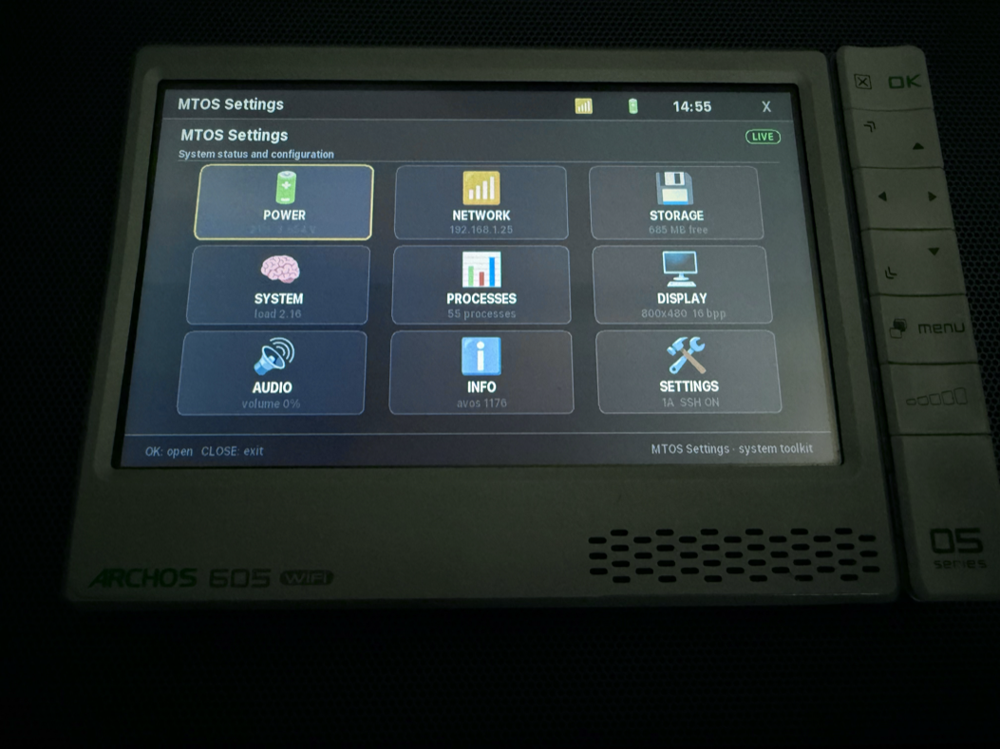
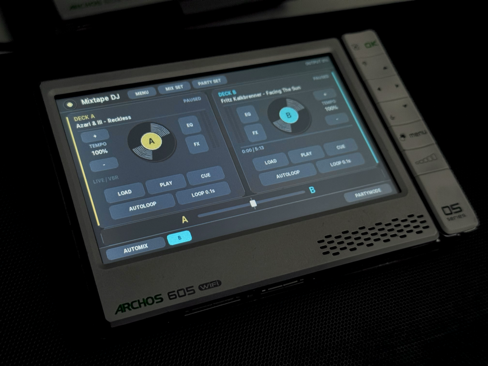
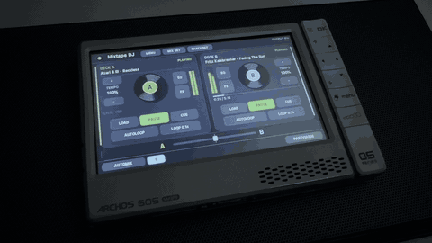

# Mixtape OS - ARCHOS 605 Custom Firmware

Found your old Archos 605 in a drawer? MixtapeOS is the reason to charge it again.

MixtapeOS turns an abandoned media player into a pocket-sized DJ booth. Replace a failed hard drive, load your music library over Wi-Fi, and dig into Mixtape DJ: a complete two-deck DJ environment with pitch control, crossfader, loops and effects. Or switch on Party Mode and let it mix your library automatically while you enjoy the party.

Built for the Archos 605 Flash and 605 HDD, Mixtape OS brings native ARM apps, SSH access and modern conveniences back to the hardware you already own — no subscriptions, no cloud account, just your music and a device with a second life.

## Preview

<table width="100%">
  <tr>
    <td width="50%" align="center">
      
    </td>
    <td width="50%" align="center">
      
    </td>
  </tr>
  <tr>
    <td width="50%" align="center">
      
    </td>
    <td width="50%" align="center">
      
    </td>
  </tr>
</table>

## Features

- No need to write internal bootloader memory = original recovery always available
- Untethered/Permanent Jailbreak+Custom Firmware
- HDD S/N Lock disabled (HDD Version)
- Charge current up to 1A
- Bugfix: Network menu,WiFi idle, standby, backlight/charge timers
- SSH/SFTP
- BusyBox 1.9.0 (/bin/busybox2) alongside stock BusyBox 1.01
- SMB2/SMB3 Fixed
- Info-menu app launcher
- Internet Radio and Web TV with a local vTuner backend and editable lists.
- Native WiFi auto-connect at boot
- Boot progress
- Native ARM Utility apps: FileExplorer, MTOS_Set
- Native ARM Live DJ app: Mixtape DJ
- Updatable Firmware and Apps via FileExplorer

## SUPPORTED DEVICES
- Archos 605 Flash (2/4 gb + SD CARD) Firmware 2.1.04 (Tested only: 4gb)
- Archos 605 HDD (>=20gb NO SD CARD) Firmware 2.1.04 (Tested only: 20gb)

## REQUIREMENTS
- USB data cable
- [Original Firmware](https://archive.org/download/firmware_a605_2.1.04)
- [Mixtape OS Custom firmware for your model (Flash or HDD)](https://github.com/mixtapeos/mixtapeos/releases/latest)

## INSTALL

### PHASE 0 - HDD REPLACEMENT (ONLY HDD VERSION IF YOUR DEVICE IS HDD-DEAD)
- Replace HDD
- Press and keep pressed the TV/LOCK button on top of device
- Press POWER button
- When display turn on, release POWER button
- When recovery menu appears, release TV/LOCK button
- Select "Format Disk" with ARROWS button e press OK button to confirm.
- When device prompt to connect pc, continue to PHASE 1 at "Connect the USB Cable and transfer original firmware"

### PHASE 1 - INSTALL ORIGINAL FIRMWARE
- Backup your device content/data
- Turn off device: Settings -> Power -> Power off
- Press and keep pressed the TV/LOCK button on top of device
- Press POWER button
- When display turn on, release POWER button
- When recovery menu appears, release TV/LOCK button
- Select "Repair Disk" with ARROWS button e press OK button to confirm.
- Connect the USB cable and transfer original firmware 2.1.04 firmware file (.aos) in the device main directory via usb mass storage
 (ARCHOS 605 Flash: firmware_a605f.aos)
 (ARCHOS 605 HDD: firmware_a605.aos)
- When transfer is complete, eject safely the device
- On device, press OK button to install firmware (USB Cable needed for charging)
- Reboot when done

### PHASE 2 - INSTALL MIXTAPE OS
- Turn off device: Settings -> Power -> Power off
- Press and keep pressed the TV/LOCK button on top of device
- Press POWER button
- When display turn on, release POWER button
- When recovery menu appears, release TV/LOCK button
- Select "Repair Disk" with ARROWS button e press OK button to confirm.
- Connect the USB cable and extract content of MIXTAPE OS archive in the device main directory via usb mass storage
 (ARCHOS 605 Flash: mtos_flash_vX.X.X_aos.zip)
 (ARCHOS 605 HDD: mtos_hdd_vX.X.X_aos.zip)
- When transfer is complete, eject safely the device
- On device, press OK button to install firmware (USB Cable needed for charging)
- When update error appears (It's ok!) press and hold POWER button until the device power off
- Press the POWER button to boot device normally
- Enjoy MIXTAPE OS

### FIRST LAUNCH
- The "App Launcher" is the "i" touch button on right side of the home screen.
- Customize MIXTAPE OS Settings: App_MTOS_Set -> Settings

## QUESTIONS
- Source code? Maybe. it takes a lot of time this work, if the community appreciate i can think about it
- Safety of this firmware? You can extract the firmware rootfs to ensure is safe.
- It's recommended to change SSH password if you use it, and avoid public wifi network.
- THIS IS THE ONLY REPO OF THIS CUSTOM FIRMWARE, DON'T DOWNLOAD ANY FIRMWARES/APPS FROM ANY OTHER WEBSITE! 

## APPLICATIONS
- [Mixtape DJ](https://github.com/mixtapeos/mixtapeos/blob/main/Manual_MIXTAPEDJ.md)
- [Mixtape Settings](https://github.com/mixtapeos/mixtapeos/blob/main/Manual_MTOSSET.md)
- [File Explorer](https://github.com/mixtapeos/mixtapeos/blob/main/Manual_FILEEXPLORER.md)

## DISCLAIMER

**Mixtape OS is an unofficial community project for the Archos 605. It is NOT
affiliated with, endorsed by, sponsored by, or supported by Archos.**

**This repository provides prebuilt firmware images and applications intended
for abandoned Archos 605 devices. It may contain third-party and proprietary
components, including components derived from the original Archos firmware.
No license is granted for those components; all rights remain with their
respective owners. Nothing in this repository gives permission to redistribute
Archos firmware, AVOS, Opera, or any other proprietary component.**

**Installing custom firmware can brick the device, void warranties, cause data
loss, or leave the device in an insecure state. You are responsible for keeping
a recovery path, backing up data, and complying with the laws and licenses that
apply in your jurisdiction. Use everything here entirely at your own risk.**

**No warranty of any kind is provided, including fitness for a particular
purpose or non-infringement. The maintainers are not liable for damage to
devices, data, networks, or third parties resulting from use of these files.**
